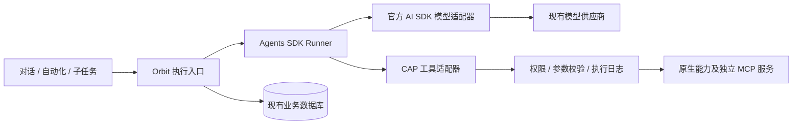

# Orbit：Agents SDK 迁移与运行说明

更新日期：2026-11-11。本文描述当前源码实现；验证结果和待验证边界见末节。服务端升级需要重新构建镜像并重建容器。

## 1. 目标与实现范围

主对话、自动化和子 Agent 共用 `executeInteractiveBrowserTurn`，其内部执行引擎已切换到 OpenAI Agents SDK 0.21.0。工具安装、配置、会话权限、浏览器连接、文件及回复块继续使用现有 CAP SDK。

已删除主执行链中的 Codex App Server 子进程管理、stdio RPC、本地 Responses 协议桥、线程绑定，以及读取或修改 rollout 工具目录的代码。没有并行保留第二套主执行引擎。

模型层只保留 OpenAI 与 Anthropic 两类协议：OpenAI 官方接口、可新增的 OpenAI 兼容接口，以及可自定义地址的 Anthropic 接口。其他供应商通过兼容接口接入，不再包含专用模型驱动、Codex CLI 模型或本地登录读取逻辑。媒体生成也只保留 OpenAI 兼容图片与语音；本地视频检查、抽帧和合成不受影响。

## 2. 模块分工

| 文件 | 职责 |
| --- | --- |
| `src/server/ai/agents/browser-chat-agents-runtime.ts` | 创建 Agent/Runner，处理模型事件、审批、工具结果、终答、上下文预算和错误状态。 |
| `src/server/ai/agents/agents-session.ts` | 使用现有数据库保存模型历史、压缩状态和审批暂停快照；检查用户归属及乐观锁。 |
| `src/server/ai/agents/agents-message-conversion.ts` | SDK 项目与 Orbit 模型消息间的投影；保留原始供应商元数据；重组工具批次及中断回执。 |
| `packages/capability-sdk/src/adapters/openai-agents/index.ts` | 通用 CAP/AI SDK 工具到 Agents 函数工具的适配；保留参数校验、调用 ID、取消信号和原有执行策略。 |
| `src/server/ai/agents/browser-chat-executor.agent.ts` | 继续提供统一业务入口、工具挂载、浏览器观察和主机权限检查。 |
| `src/server/ai/agents/runtime-context-runtime.ts` | 复用已有上下文预算、摘要、原始指令保护、归档和压缩替换逻辑。 |
| `src/server/ai/agents/runtime-execution-journal.ts` | 保留工具计划、开始、结果及不确定状态，防止把中断操作直接当作成功重放。 |
| `src/server/ai/runtime-errors.ts` | 统一保留内部错误证据；公开显示继续使用中性运行名称。 |

主执行链新增 `@openai/agents-core` 和 `@openai/agents-extensions`，版本均固定为 0.21.0。扩展包的模型适配器支持当前 AI SDK 7；现有模型地址、密钥、请求参数、敏感数据处理和供应商设置继续由原模型层负责。SDK 的包依赖及 peer 依赖以 lockfile 为准。

供应商清理从 Orbit 与 CAP 的直接依赖中移除了 19 个适配包声明，npm 实际移除了 25 个包。`@ai-sdk/gateway` 仍是 `ai@7.0.59` 的强制传递依赖，且由其模块直接导入；Orbit 不再提供网关供应商入口，也不走默认网关解析。强行从 node_modules 删除该包会破坏 SDK 加载。保留的模型适配入口是 `@ai-sdk/openai`、`@ai-sdk/openai-compatible`、`@ai-sdk/anthropic`，其余 AI SDK 包负责协议类型、MCP、前端流和监控。

原生视频生成驱动随专用供应商适配器移除，图片与语音仍可通过 OpenAI 兼容协议生成。OpenAI 官方的 [视频生成说明](https://developers.openai.com/api/docs/guides/video-generation) 标注 Sora 2 / Videos API 已于 2026-09-24 关闭，因此没有用已关闭的接口替代视频驱动。本地抽帧、视频编辑与合成继续使用现有工具。第三方的非兼容生成协议可以由独立 MCP 工具提供。

## 3. 历史与数据库

模型历史使用现有 `workspace_record`，不新增数据库表：

| 字段 | 值 |
| --- | --- |
| `collection` | `execution` |
| `owner_kind` | `runtime` |
| `partition_id` | Orbit 会话 ID；没有会话 ID 时使用运行 ID |
| `scope_id` | `agents-sdk:<contextScope>`；默认 `agents-sdk:main` |
| `kind` / `id` | `state` / `current` |

记录保存 `userId`、`revision`、SDK 格式历史、压缩状态，以及可选审批暂停快照。读取时检查记录中的用户归属；更新时按 revision 比较后提交。数据库提交成功后才更新内存状态，失败的写入会阻止该实例后续写入及依赖该检查点的操作。

当前选择 SDK 官方支持的**应用管理历史回放**策略：Orbit 从数据库读取历史作为 Runner 输入，再保存实际发送的历史投影、模型输出和工具结果。`OrbitAgentSession` 实现 Session 接口，但该执行路径不同时向 Runner 传入 `session`，也不使用 `conversationId` 或 `previousResponseId`，避免数据库历史与 SDK 自动历史追加两次。

首次创建该作用域时，可以使用业务入口提供的对话消息建立初始历史。不会读取或转换旧 Codex rollout，也不依赖旧线程绑定。业务消息、日志与归档继续服务 UI 和审计，后续模型请求从数据库 Agent 会话恢复。

## 4. 上下文与压缩

每次模型调用前，通过 `callModelInputFilter` 调用现有 `prepareRuntimeContext`：

1. 使用模型设置中的上下文窗口和安全预留计算输入预算。
2. 按预算加入当前实际可用工具对应的运行资料、知识和观察。
3. 达到压缩阈值后，复用语义摘要、最近工具交换保护及历史证据归档。
4. 先保存摘要的原始证据，再提交替换后的模型历史。
5. 超出硬容量时返回明确错误，避免发送已超限的请求。

压缩采用主模型的独立摘要请求；该请求不是答案二次审核。摘要请求有取消信号和运行超时。摘要结果的校验与重试继续使用已有通用逻辑。

同一 SDK 运行内只向已压缩投影加入新产生的后缀，避免每轮重新扩回原始历史。供应商的签名、reasoning 元数据等保留在原始 SDK 项目中；没有改写的消息按内容引用复用原项目，不把 SDK 的标量传输字段误当成 AI SDK 的 providerOptions。

工具批次中的多个 function call 必须共同投影为同一 assistant 交换，再附上对应结果，防止把已完成的兄弟调用错误修复成结果未知。

## 5. 工具与审批

工具目录继续由安装状态、部署授权、全局开关、会话关闭列表和用户权限共同决定；执行前再次检查。MCP 的安装、服务配置、服务级及工具级开关继续使用已有管理层。

CAP 的新适配器复用原工具 schema 和执行器，不复制浏览器、终端或文件业务实现。它把真实调用 ID 和取消信号传入既有工具调用上下文。输入先完成权威校验，再记录工具开始，避免将参数错误误记为已经执行的操作。

适配器会把 AI SDK 输出的 JSON Schema 转为纯 JSON。AI SDK 可能在 schema 对象上附带非枚举 Standard Schema 适配信息；直接交给 Agents 会被误识别为另一类 schema，并报 `Strict mode is required for Standard Schema parameters`。序列化去除适配元数据后，模型仍得到原 JSON Schema，参数仍由 CAP 校验。

审批过程：

1. SDK 在调用前返回 `interruptions`，工具尚未执行。
2. Orbit 保存 `RunState`、对应运行 ID、准备好的上下文及输入位置。
3. 将审批交给现有 Orbit 确认入口及权限策略。
4. 批准或拒绝后，从同一个 SDK state 继续，不重发用户问题。

同一次运行的审批暂停可以从数据库恢复。工具即将执行时先使旧审批快照失效，再写入执行开始日志；进程中断后不会凭该旧快照重复执行已经开始的动作。

共享执行日志按批次保存工具计划和结果。当前 SDK 本地函数执行并发设置为 1，与日志的单批次提交方式配合；现有 `subagent` 工具内部仍使用原有受限并发批次执行。恢复逻辑把已保存结果放回原调用；缺少结果的操作保留“未执行”或“结果未知”证据，要求重新检查实际状态。

SDK 在调用执行器前拒绝的无效 JSON、参数或调用也需要进入 Orbit 日志，不能只存在于 SDK 内存历史中。

## 6. 流式输出、终答与日志

官方模型适配器提供的原始模型事件用于文本、思考、工具参数、首包和输出速度更新。最终回复工具的 Markdown 参数不必等待完整 JSON，仍在对应工具行下展示草稿。工具调用 ID 始终沿用供应商提供的 ID；文本和思考项另加模型请求 ID，避免供应商重复使用 `text-0` 一类局部 ID 时覆盖前一次输出。

Token 数据以供应商返回的用量为准；生成中的速度估算明确带 estimated 标记。每个 token 不写数据库日志，只发布临时 UI 状态；工具启动、进度、结束和实际模型请求用量仍保留。模型适配器直接调用 provider 时，应用补录原有本地 Token、缓存命中、首包与速度指标，并遵守 AI_TELEMETRY_ENABLED 开关。

终答继续使用 CAP 的 `ResponseSession` 和回复块注册表。只有终答被接受或需要人工输入时才结束；终答 schema、完成声明、未结束工具及待人工输入校验保留。没有加入新的模型二次审核。普通文本终答经过同一回复工具和程序校验路径。

主任务、自动化和子任务均通过同一执行入口使用新引擎；子任务的上下文作用域、结果回传、并发限制和 UI 结构继续由现有业务层管理。单次任务模型轮数由 AI_RUNTIME_MAX_TURNS 控制，默认 100，审批恢复沿用原任务计数，防止持续的无效工具/终答循环。SDK tracing 明确关闭，现有本地日志继续保留，不自动把会话追踪上传到外部服务。

## 7. 修改后的验证与交付边界

本轮按要求不运行 dev/build，不新增测试文件。静态检查和内联隔离调用不会修改正式业务数据库，也不使用真实模型密钥。提交并推送源码不等于构建新镜像或更新现有容器。

隔离验证使用真实 Agents Runner、官方 AI SDK 模型适配器、真实 CAP 回复工具、本地模拟供应商 HTTP/SSE，以及独立 SQLite 数据库。成功返回 `2` 只证明此隔离链路成立，不证明真实浏览器业务任务成功。

已完成的内联隔离调用：

| 场景 | 实际结果 |
| --- | --- |
| 单工具后终答 | 2 次模型请求、1 次工具执行，回复 `2`，11 次草稿更新；没有额外模型复审。 |
| 两类模型协议 | OpenAI 兼容与 Anthropic HTTP/SSE 均通过实际 Runner 完成工具及终答；原生 OpenAI Responses 请求也通过隔离调用。 |
| 媒体模型协议 | OpenAI 与 OpenAI 兼容图片、语音均产生有效产物回执；URL 图片下载不携带模型密钥；失败只请求一次；缺失模型和已移除供应商明确拒绝。 |
| 同批两个工具 | 2 次模型请求、2 次工具执行，两个结果均进入下一次模型输入。 |
| 多轮续聊 | 两轮共 3 次模型请求，历史用户消息数量正确，第一轮工具没有重放。 |
| 审批暂停后重新进入同一运行 | 暂停时未执行；恢复后只执行 1 次工具，两次模型请求完成。 |
| 审批拒绝 | 0 次工具执行，拒绝回执进入模型历史。 |
| 参数类型错误、无效 JSON | 均未执行工具；保留失败回执并允许模型继续处理。 |
| 工具执行中取消 | 恢复输入包含 outcome=unknown；没有自动重复执行原工具。 |
| 普通文本终答 | 1 次模型请求，经过同一 CAP 回复工具及完成校验结束。 |
| 不完整终答 | 第一次终答未被接受，第三次模型请求提交完整终答后结束。 |
| 图片 | 图片以实际媒体出现在本地供应商请求中，而不是混在工具 JSON 文本中。 |
| 长上下文 | 实际调用本地摘要接口生成 6 份摘要；完成后继续工具及终答；压缩完成事件在提交后发布。 |
| 用户、分支及并发写入 | 异用户读取拒绝；分支无串读；过期 revision 写入拒绝且保留原历史。 |
| 本地监控 | 模型调用及缓存命中指标存在；模拟供应商 100/200 缓存命中记录为 0.5。 |

静态检查包括生产源码类型（排除旧 test/spec 源码）、后端类型、CAP SDK 类型、改动源码 ESLint、Node 后端模块边界及 diff 空白检查。具体检查不包含运行构建产物。

供应商侧边栏使用独立的 `ModelProviderRow` 组件，列表按内容排列，统一行高、状态点、删除槽及长名称省略。使用实际组件服务端渲染和实际样式，经 CAP 浏览器核对明暗主题与 1440、760、390px 视口；覆盖纵向和横向滚动，无页面横向溢出。该检查不是完整设置路由的登录、保存或拖拽端到端验收。

后续内联验证覆盖当前数据库迁移后的实时 WebSocket 握手、一次性票据防重放和用户隔离；真实浏览器覆盖刷新事件、订阅切换与断线恢复。工具展示使用实际对话组件核对运行中、晚到事件和完成后展开的顺序，并检查明暗主题及窄屏；这些组件与传输检查不代表完整业务任务端到端验收。

真实供应商、真实浏览器、自动化调度及完整前端流式显示，需要在部署更新并重启服务后另行验证，不能从静态检查或模拟接口推断。镜像大小、真实业务成功率和延迟尚未测量。

## 8. 官方参考

- [Agents SDK 运行循环与会话策略](https://developers.openai.com/api/docs/guides/agents/running-agents)
- [模型和供应商](https://developers.openai.com/api/docs/guides/agents/models)
- [审批与暂停恢复](https://developers.openai.com/api/docs/guides/agents/guardrails-approvals)
- [结果和状态](https://developers.openai.com/api/docs/guides/agents/results)
